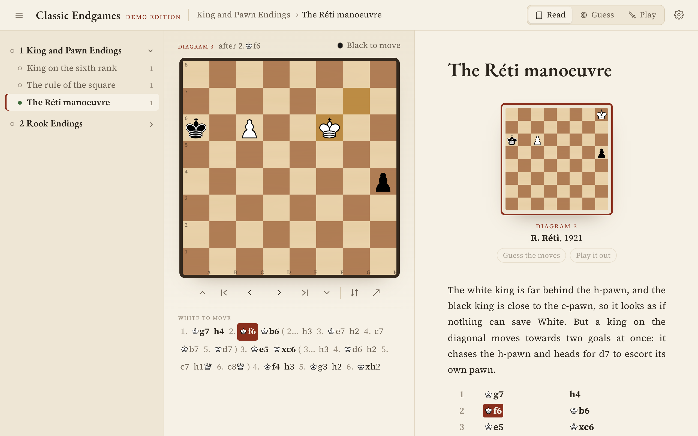
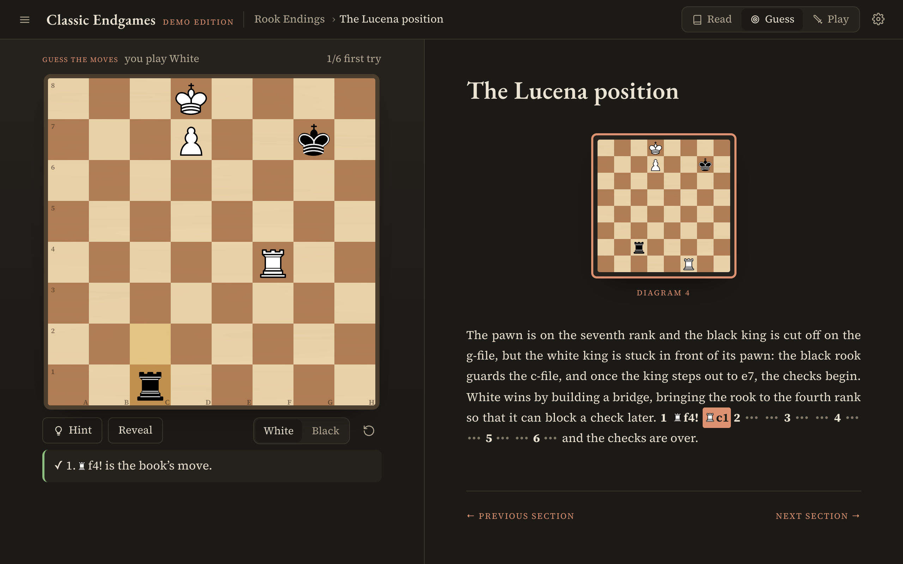
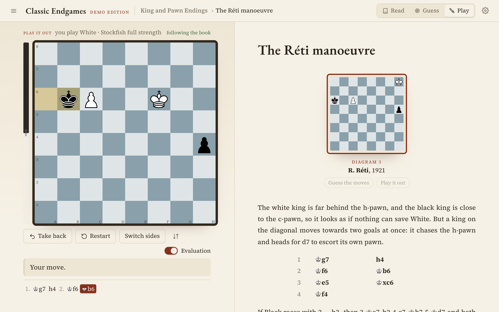

# Keres Endings — an unofficial companion to Paul Keres' *Practical Chess Endings*

[](https://github.com/Enea-13/keres-endings/actions/workflows/ci.yml)

A study app for Paul Keres' *Practical Chess Endings* (879 diagrams, about 18,000 printed
moves), built from the book's PDF by a Python pipeline that recognises every diagram and links
every move in the text to a board position. In the app every diagram is a live position,
every move printed in the text is clickable, and each position can be trained ("guess the
moves") or played out against Stockfish.

**[Try the demo](https://enea-13.github.io/keres-endings/)**: five classic endgames with
commentary written for this repository, built by the same pipeline. The book itself is not
part of the repository (see [Disclaimer](#disclaimer)).



| Guess the moves | Play it out against Stockfish |
| --- | --- |
|  |  |

## How it works

Turning the book's PDF into data takes three steps, all in `pipeline/`:

1. **Text and structure** (`extract.py`, PyMuPDF). The PDF becomes a reading-order stream:
   headings from the PDF outline, paragraphs with their bold and italic runs (bold marks the
   main line), main-line tables and diagram images.
2. **Diagrams to positions** (`diagrams.py`). Each diagram image is located by its board
   frame, cut into 8×8 cells and classified by shift-tolerant template matching. The 26
   templates (each piece and the empty square, on light and dark squares) are learned from the
   book's own diagrams. Diagrams that print two positions are split.
3. **Notation to move trees** (`notation.py`, python-chess). The figurine notation is parsed
   into move sequences, and each one is attached to the position it starts from. The pipeline
   tries the likely parents (the diagram under discussion, the line just given, the diagrams
   the sentence refers to) and keeps the one where every move is legal and every printed "+"
   really gives check. Lines resume after bracketed asides, and a reply the text skips is
   filled in as a pass or, after a check, as the forced move.

Results on the book:

- 879 diagrams become 893 positions (14 diagrams print two). 549 of them are confirmed
  independently, because the book's moves lead exactly to the printed diagram.
- 98.5% of the printed moves (17,580 of 17,855) are linked to a board position.
- 36 hypothetical positions that the text describes but does not print ("with the white king
  on f2…", "moved one file to the left") are built from their diagrams
  (`pipeline/overrides.json`, `positions.py`). The board labels them as *Hypothetical*.
- Two misprinted diagrams in the book (138 and 485) are detected, and the board shows the
  position the moves actually reach.
- The 72 sequences still not linked are shown in grey. They are mostly variations inside other
  hypotheticals, lines that are illegal on purpose ("preventing 2 ♔e2"), and a few tangles in
  deeply nested analysis. The app's `/qa` page lists them next to every printed diagram and
  the position recognised from it.

The app (`app/`) is Vite + React 19 + TypeScript with chessground and chessops. Section files
are lazy-loaded and the next one is prefetched. All positions are precomputed, so stepping
through a line costs well under a millisecond of main-thread work. Chessground updates the
board outside React's render cycle, and Stockfish 19 (single-threaded WASM) only loads when
Play mode is opened.

```
pipeline/            Python: PDF -> JSON (one-time, reproducible)
  extract.py         reading-order stream from the PDF
  diagrams.py        diagram image -> position (templates/ holds the learned piece templates)
  notation.py        figurine notation -> move trees attached to positions
  positions.py       builds hypothetical positions ("king on c6", "one file to the left")
  overrides.json     manual fixes, each matched to its paragraph by page + text
  build.py           writes app/public/content/{toc.json, sections/*.json, qa.json}
  demo.py            builds the demo from demo/endings.txt with the same Builder
  debug_unit.py      prints the text around a diagram with what was recognised
  tests/             pytest
demo/endings.txt     the demo's positions and commentary, in the book's notation
app/                 Vite + React 19 + TypeScript, Tailwind CSS v4, chessground, chessops,
                     zustand, motion, Stockfish 19 lite (WASM worker)
```

## Run it

**Without the book**, the demo:

```bash
./start.sh --demo
```

**With your copy of the book**, put the PDF at `book.pdf` in the project root (it is
git-ignored), then:

```bash
./start.sh
```

On the first run this sets up the Python pipeline, extracts the book from the PDF (about
15 seconds), installs the app and opens it in your browser. Later runs only rebuild and
serve the app. The extracted content goes to `app/public/content/` and `app/public/qa/`,
which are git-ignored.

- `./start.sh --dev` runs the Vite dev server with hot reload (http://localhost:5317).
- `./start.sh --rebuild-content` re-extracts everything from the PDF.
- To read the PDF from somewhere else, use `KERES_PDF=/path/to/book.pdf ./start.sh`.

Requirements: Python 3.9+ and Node.js 22.12+.

## Using the app

- **Read**: the board column sits next to the book text. Click any move or diagram, or
  use the keys: `←` `→` move through the line, `↑` `↓` jump between diagrams,
  `Home`/`End` go to the start or end of the line, `F` flips the board.
  - When you scroll the text, the board follows to the diagram you are reading (you can
    switch this off in Settings).
  - Moves you play on the board follow the book's tree. If you play a move the book doesn't
    give, a dashed "your analysis" line starts, and `Esc` returns to the book.
  - The arrow button shows the book's moves from the current position.
- **Guess**: start from any diagram ("Guess the moves" under it, or the *Guess* tab).
  - You play one side of the main line. A wrong move is rejected. A move the book only
    examines as a side line is recognised as such.
  - Hints highlight the piece to move, then show the move itself.
  - The commentary is revealed as you find the moves, and later moves stay hidden. Scores
    are kept per diagram.
- **Play**: play the current position out against Stockfish 19 (WASM, offline).
  - You can take moves back, switch sides, and show an evaluation bar.
  - The strength is set in Settings. The panel shows whether the game is still following
    the book.
- **Settings** (gear icon): Paper or Night theme, board style (Wood, Book print, Slate),
  coordinates, sounds, and engine strength.

Progress (sections read, diagrams studied, guess scores, last position) is kept in the
browser's local storage.

## The demo

`demo/endings.txt` holds five well-known endgames (king on the sixth rank, the rule of the
square, the Réti study, the Lucena and Philidor positions) with commentary written for this
repository, in the same figurine notation as the book. `pipeline/demo.py` feeds it through
the book's `Builder`, so its moves are linked to positions by the same code, and its lines
were checked with Stockfish. The format is described at the top of `demo.py`.

`npm run build:demo` (in `app/`) builds the app with the demo content in place of the book's.
The [Demo workflow](.github/workflows/pages.yml) publishes it to GitHub Pages on every push
to `main` (once the repository is public and Pages is set to deploy from GitHub Actions).

## Tests

```bash
cd pipeline && .venv/bin/python -m pytest -q
cd app && npm test
```

[CI](.github/workflows/ci.yml) runs both, type-checks and builds the app, and builds the demo,
which fails if any of its moves cannot be linked to a position.

## Disclaimer

This is an independent project. It is not affiliated with or endorsed by Paul Keres' estate
or the book's publishers. The repository contains no text, diagrams or scans from *Practical
Chess Endings*, apart from the short phrases in `pipeline/overrides.json` that locate each
manual fix in the text. The full app only works with a copy of the book you own.

## License

The code is licensed under the GNU General Public License v3.0 or later (see
[LICENSE](LICENSE)), like chessground, chessops and Stockfish, which it builds on. The
cburnett piece set keeps its own license, CC BY-SA 3.0.

## Credits

Chess pieces: cburnett set by Colin M. L. Burnett (CC BY-SA 3.0). Board: chessground (GPL-3.0).
Move logic: chessops (GPL-3.0). Engine: Stockfish via stockfish.js (GPL-3.0).
Pipeline: PyMuPDF (AGPL-3.0) and python-chess (GPL-3.0).
